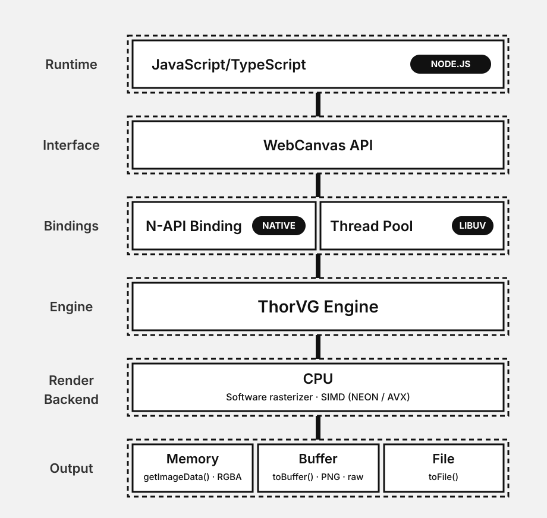

# ThorVG for Node.js

Headless vector graphics and Lottie rendering powered by [ThorVG](https://github.com/thorvg/thorvg).

## Installation

```sh
npm install thorvg-canvas
```

## Usage

```ts
import { init } from 'thorvg-canvas';

const TVG = await init();
const canvas = new TVG.Canvas({ width: 512, height: 512 });

const animation = new TVG.LottieAnimation();
await animation.load(lottieJson);
canvas.add(animation.picture);

const { totalFrames } = animation.info()!;
for (let frame = 0; frame < totalFrames; frame++) {
  animation.frame(frame);
  await canvas.update().renderAsync();
  await canvas.toFile(`frame-${frame}.png`);
}
```

## Architecture

The API is compatible with [`@thorvg/webcanvas`](https://www.npmjs.com/package/@thorvg/webcanvas). In Node the
same classes run on the native ThorVG engine through [Node-API](https://nodejs.org/api/n-api.html), rendering
on the CPU into memory.

<p align="center">
  
</p>


## Development

```sh
git submodule update --init
yarn install
yarn build        # build:thorvg → build:native → build:ts
yarn typecheck    # includes the webcanvas parity check
yarn test
yarn test:visual  # pixel comparison against @thorvg/webcanvas
```

Note: Requires meson, ninja and a C++17 toolchain.
